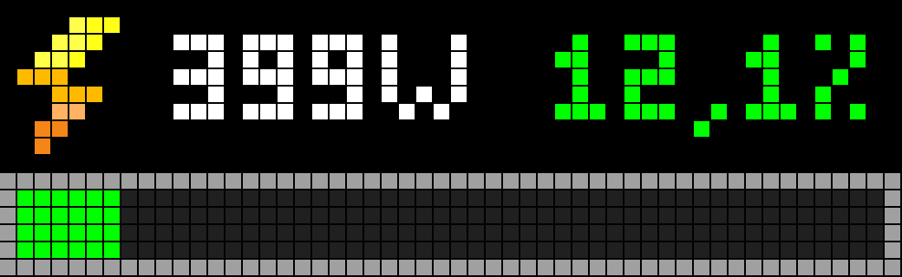
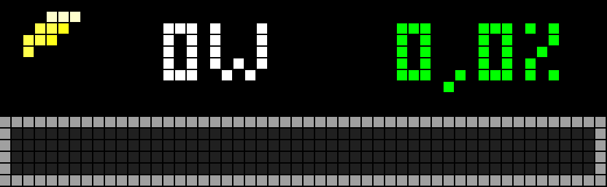
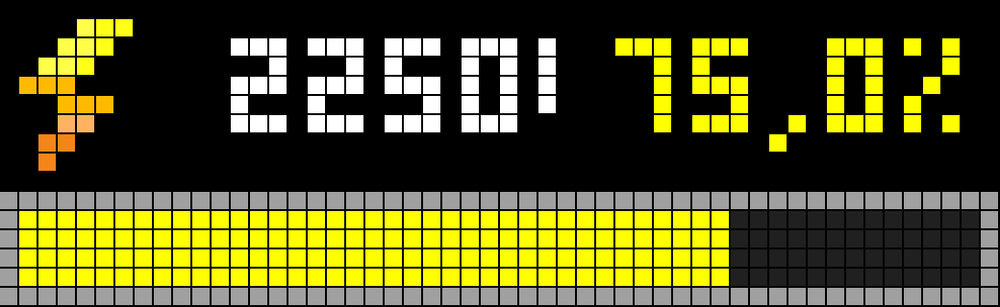

# AWTRIX NG Electricity Consumption for Home Assistant

**Author:** ML  
**Release:** 1.0

A Home Assistant automation blueprint for the Ulanzi TC002 running AWTRIX NG, communicating over MQTT. The repository provides five localized blueprint files; this README and the changelog are maintained in English.

## Available blueprints and one-click import

Choose your language and select **Import** to open the Home Assistant blueprint import page. Review the blueprint and confirm the import in Home Assistant.

| Language | YAML file | Import |
|---|---|---|
| English | [`awtrix_ng_electricity_consumption_en.yaml`](https://github.com/mlopez721/awtrix-ng-electricity-consumption/blob/main/awtrix_ng_electricity_consumption_en.yaml) | [Import English blueprint](https://my.home-assistant.io/redirect/blueprint_import/?blueprint_url=https%3A%2F%2Fraw.githubusercontent.com%2Fmlopez721%2Fawtrix-ng-electricity-consumption%2Fmain%2Fawtrix_ng_electricity_consumption_en.yaml) |
| Spanish | [`awtrix_ng_consumo_electrico_es.yaml`](https://github.com/mlopez721/awtrix-ng-electricity-consumption/blob/main/awtrix_ng_consumo_electrico_es.yaml) | [Import Spanish blueprint](https://my.home-assistant.io/redirect/blueprint_import/?blueprint_url=https%3A%2F%2Fraw.githubusercontent.com%2Fmlopez721%2Fawtrix-ng-electricity-consumption%2Fmain%2Fawtrix_ng_consumo_electrico_es.yaml) |
| German | [`awtrix_ng_stromverbrauch_de.yaml`](https://github.com/mlopez721/awtrix-ng-electricity-consumption/blob/main/awtrix_ng_stromverbrauch_de.yaml) | [Import German blueprint](https://my.home-assistant.io/redirect/blueprint_import/?blueprint_url=https%3A%2F%2Fraw.githubusercontent.com%2Fmlopez721%2Fawtrix-ng-electricity-consumption%2Fmain%2Fawtrix_ng_stromverbrauch_de.yaml) |
| French | [`awtrix_ng_consommation_electrique_fr.yaml`](https://github.com/mlopez721/awtrix-ng-electricity-consumption/blob/main/awtrix_ng_consommation_electrique_fr.yaml) | [Import French blueprint](https://my.home-assistant.io/redirect/blueprint_import/?blueprint_url=https%3A%2F%2Fraw.githubusercontent.com%2Fmlopez721%2Fawtrix-ng-electricity-consumption%2Fmain%2Fawtrix_ng_consommation_electrique_fr.yaml) |
| Portuguese | [`awtrix_ng_consumo_eletrico_pt.yaml`](https://github.com/mlopez721/awtrix-ng-electricity-consumption/blob/main/awtrix_ng_consumo_eletrico_pt.yaml) | [Import Portuguese blueprint](https://my.home-assistant.io/redirect/blueprint_import/?blueprint_url=https%3A%2F%2Fraw.githubusercontent.com%2Fmlopez721%2Fawtrix-ng-electricity-consumption%2Fmain%2Fawtrix_ng_consumo_eletrico_pt.yaml) |

All five files are intended to provide the same functionality, with blueprint names, descriptions, and interface options localized. The spoken alarm remains in English, as that is the voice tested with AWTRIX NG.

## Demonstrations

The following animated GIFs show the blueprint running on a Ulanzi TC002 with AWTRIX NG.

### Normal operation

The display during normal operation, showing the current readings and progress bar.

### Test mode: 0% to 50%

Test mode simulating consumption levels from 0% to 50%.

### Test mode: 75% to 100% with alert

Test mode simulating consumption from 75% to 100%, including the configured alert at the threshold.

## Features

- Displays current power and consumption percentage, with independent horizontal scrolling when either text does not fit.
- Uses the animated `lightningbolt` icon in a separate region.
- Configurable progress bar with a visible grey border and adjustable inner height from 1 to 6 pixels.
- Three configurable colour zones: green, yellow, and red.
- Displays percentages above 100%, while visually capping the progress bar at 100%.
- Optional text blinking at or above 100%.
- Optional alarm: RTTTL siren or English speech; only one alarm mode can be selected at a time.
- Test mode simulates 0%, 25%, 50%, 75%, and 100% at five-second intervals, including the alarm at 100% when enabled.
- Publishes on Home Assistant startup, when sensor values change, and every five seconds.

## Requirements

1. Home Assistant with MQTT configured.
2. An Ulanzi TC002 running AWTRIX NG, with a 52 × 16 pixel display.
3. A power sensor measured in watts and a consumption-percentage sensor.
4. The `lightningbolt` icon installed locally on the TC002.

## Installation

1. Use the language-specific **Import** link in the table above. Alternatively, open **Settings → Automations & scenes → Blueprints → Import Blueprint** and paste the raw URL of the selected YAML file.
2. Review and confirm the import in Home Assistant.
3. Create an automation from the imported blueprint and select the AWTRIX device and the two sensor entities.
4. If the icon is not already installed, open the AWTRIX NG web interface, go to **Icons → Add**, search for `lightningbolt` in AWTRIX Hub, and send it to AWTRIX. Confirm that its installed ID is exactly `lightningbolt` (without `.gif`).
5. Run test mode first and check the display and alarm before enabling normal operation.

The icon file is not included in this repository. Each user must download it from AWTRIX Hub to their own device.

## Official documentation

- [Home Assistant — Using automation blueprints](https://www.home-assistant.io/docs/automation/using_blueprints/)
- [AWTRIX NG documentation](https://blueforcer.github.io/awtrix-ng/)
- [AWTRIX NG — TC002 icons guide](https://blueforcer.github.io/awtrix-ng/tc002/guides/icons/)

## Release status

Version **1.0** is the initial public release. The Spanish blueprint has been tested successfully on the author's TC002. The other localized files have been prepared but should be tested on the intended Home Assistant and AWTRIX NG setup before being considered confirmed. Test your own configuration and firmware compatibility before relying on it in production.
